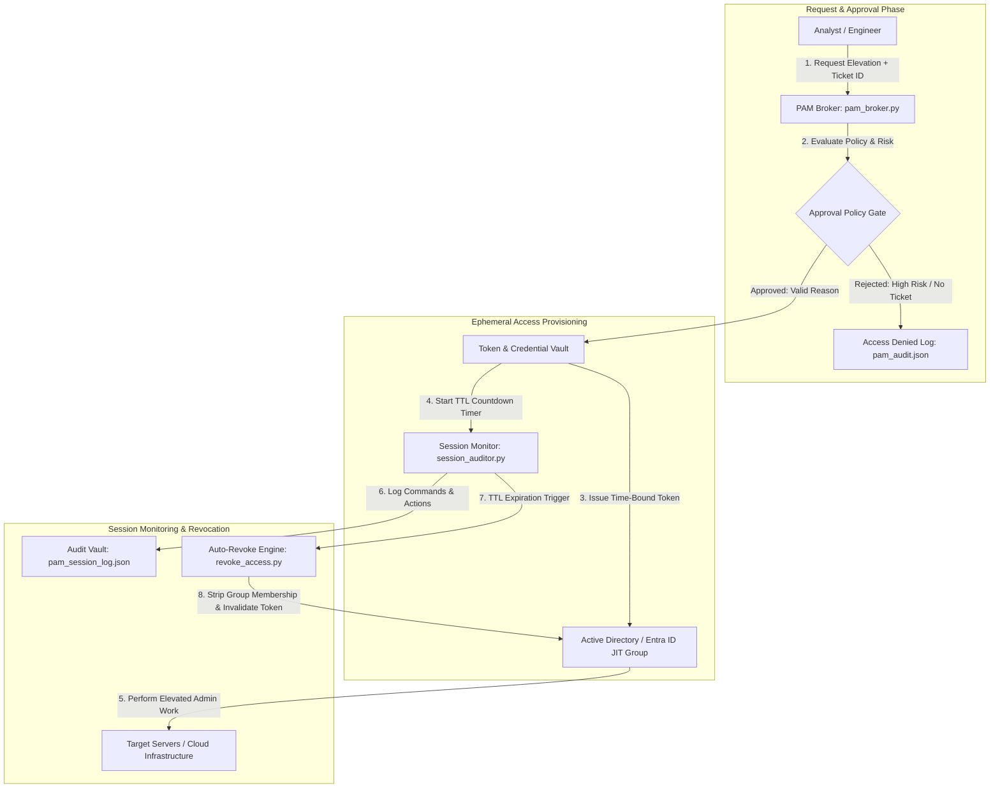

# Privileged Access Management (PAM) & JIT Elevation Simulator

## Overview
A Privileged Access Management (PAM) and **Just-In-Time (JIT) access brokering engine** designed to simulate enterprise Zero Standing Privileges (ZSP) architectures.

The simulator models the complete privileged lifecycle: self-service access requests, policy-driven approval workflows, time-bound ephemeral credential/group issuance, real-time command session auditing, and automatic permission revocation upon Time-To-Live (TTL) expiration.



---

## Key Capabilities

* **Zero Standing Privileges (ZSP):** Enforces a baseline where administrative accounts possess zero standing domain or cloud permissions until an approved JIT session is active.
* **Just-In-Time (JIT) Ephemeral Brokering:** Dynamically generates time-limited session tokens (e.g., 30-minute, 1-hour windows) and provisions temporary directory group memberships.
* **Automated TTL Revocation Worker:** Background scheduler monitors active sessions and automatically executes deprovisioning routines the moment session TTL expires.
* **Session Telemetry & Command Auditing:** Captures full command history and target system connections executed during the elevated window into an immutable audit trail.
* **Change Ticket & Reason Code Enforcement:** Requires correlation with a valid Change Request (CR) or Incident Ticket ID prior to grant approval.
* **Compliance Framework Alignment:** Directly satisfies requirements under **NIST CSF v2.0 (PR.AC-04 - Privileged Access Management)**, **CIS Controls v8 (Control 5 - Account Management & Control 6 - Access Control Management)**, and **SOC 2 Type II (Trust Services Criteria - Logical Access)**.

---

## Architecture & Tech Stack

* **Core Engine:** Python 3 (Access Brokering, Cryptographic Token Generation, TTL Scheduling)
* **Directory Integration:** PowerShell Core / ActiveDirectory module (Dynamic Group Provisioning & Stripping)
* **Security Standards:** HMAC-SHA256 Token Validation, JSON Schema Normalization
* **Testing Suite:** PyTest with mocked time-drift and automated revocation suites

---

## Directory Structure

```text
|-- README.md                         # Architecture documentation and usage guide
|-- LICENSE                           # MIT License
|-- pam_broker.py                     # Main JIT request and authorization engine
|-- session_auditor.py                # Command recorder and active session tracker
|-- revoke_access.py                  # Ephemeral deprovisioning worker
|-- config/
|   |-- pam_policy.json               # Elevation rules, maximum TTLs & approval thresholds
|   `-- privileged_roles.json         # Mappings of target roles to AD/Entra ID groups
|-- data/
|   `-- active_sessions.json          # Active ephemeral session state database
|-- outputs/
|   |-- pam_session_log.json          # Immutable privileged session audit logs
|   `-- pam_compliance_summary.json   # Aggregated governance metrics for auditors
`-- tests/
    `-- test_pam_broker.py            # Unit tests for TTL expiry and request validation
```

---

## PAM Broker Engine (`pam_broker.py`)

```python
import json
import uuid
import hashlib
from datetime import datetime, timedelta

def load_policy():
    with open("config/pam_policy.json", "r", encoding="utf-8") as f:
        return json.load(f)

def request_elevation(user: str, target_role: str, ticket_id: str, duration_minutes: int) -> dict:
    policy = load_policy()
    max_duration = policy.get("max_duration_minutes", 60)
    allowed_roles = policy.get("allowed_roles", [])

    # 1. Validation & Policy Gate
    if not ticket_id or not ticket_id.startswith(("INC-", "CHG-", "SEC-")):
        return {"status": "REJECTED", "reason": "Invalid or missing Change/Incident Ticket ID"}

    if target_role not in allowed_roles:
        return {"status": "REJECTED", "reason": f"Target role '{target_role}' not authorized for JIT elevation"}

    duration = min(duration_minutes, max_duration)
    session_id = f"PAM-{uuid.uuid4().hex[:8].upper()}"
    start_time = datetime.utcnow()
    expires_at = start_time + timedelta(minutes=duration)

    # 2. Generate Cryptographic Ephemeral Token
    token_seed = f"{user}:{session_id}:{expires_at.isoformat()}"
    ephemeral_token = hashlib.sha256(token_seed.encode("utf-8")).hexdigest()[:32]

    session_record = {
        "session_id": session_id,
        "user": user,
        "target_role": target_role,
        "ticket_id": ticket_id,
        "ephemeral_token": ephemeral_token,
        "start_time": start_time.isoformat() + "Z",
        "expires_at": expires_at.isoformat() + "Z",
        "duration_minutes": duration,
        "status": "ACTIVE"
    }

    # 3. Persist Active Session
    with open("data/active_sessions.json", "w", encoding="utf-8") as f:
        json.dump([session_record], f, indent=2)

    print(f"[PAM APPROVED] Granted {target_role} to {user} for {duration}m. Session: {session_id}")
    return {"status": "APPROVED", "session": session_record}

if __name__ == "__main__":
    request_elevation("jsmith@enterprise.local", "Domain_Admin_JIT", "CHG-2026-9941", 30)
```

---

## Automatic Revocation Worker (`revoke_access.py`)

```python
import json
from datetime import datetime

def check_and_revoke_sessions():
    with open("data/active_sessions.json", "r", encoding="utf-8") as f:
        sessions = json.load(f)

    now = datetime.utcnow()
    active_remaining = []
    revoked_count = 0

    for s in sessions:
        expires_at = datetime.fromisoformat(s["expires_at"].replace("Z", ""))
        if now >= expires_at and s["status"] == "ACTIVE":
            s["status"] = "EXPIRED_AND_REVOKED"
            s["revoked_at"] = now.isoformat() + "Z"
            print(f"[REVOKED] Session {s['session_id']} for {s['user']} expired. Privileges stripped.")
            revoked_count += 1
            
            # Log to historical audit trail
            with open("outputs/pam_session_log.json", "a", encoding="utf-8") as audit_f:
                audit_f.write(json.dumps(s) + "\n")
        else:
            active_remaining.append(s)

    with open("data/active_sessions.json", "w", encoding="utf-8") as f:
        json.dump(active_remaining, f, indent=2)

    print(f"Revocation worker run completed. {revoked_count} sessions decommissioned.")

if __name__ == "__main__":
    check_and_revoke_sessions()
```

---

## Sample Privileged Session Lifecycle & Audit Output

### Active Ephemeral Session Grant (`data/active_sessions.json`)
```json
[
  {
    "session_id": "PAM-E49A1F2C",
    "user": "jsmith@enterprise.local",
    "target_role": "Domain_Admin_JIT",
    "ticket_id": "CHG-2026-9941",
    "ephemeral_token": "9a7f82b1c4e5d6a8f0123456789abcde",
    "start_time": "2026-08-25T18:15:00Z",
    "expires_at": "2026-08-25T18:45:00Z",
    "duration_minutes": 30,
    "status": "ACTIVE"
  }
]
```

### Completed Session Audit Record (`outputs/pam_session_log.json`)
```json
{
  "session_id": "PAM-E49A1F2C",
  "user": "jsmith@enterprise.local",
  "target_role": "Domain_Admin_JIT",
    "ticket_id": "CHG-2026-9941",
  "start_time": "2026-08-25T18:15:00Z",
  "expires_at": "2026-08-25T18:45:00Z",
  "revoked_at": "2026-08-25T18:45:01Z",
  "status": "EXPIRED_AND_REVOKED",
  "commands_executed": [
    "GEt-ADUser -Filter *",
    "Restart-Service -Name W32Time"
  ]
}
```

---

## Getting Started

### 1. Prerequisites
* Python 3.8+
* PyTest (`pip install pytest`)

### 2. Execution & Lifecycle Testing
```bash
# Clone the repository
git clone https://github.com/elazarf123/iam-pam-simulator.git
cd iam-pam-simulator

# 1. Request JIT privileged elevation
python pam_broker.py

# 2. Simulate administrative session activity
python session_auditor.py

# 3. Trigger revocation worker
python revoke_access.py

# 4. Run automated test suite
pytest tests/ -v
```

